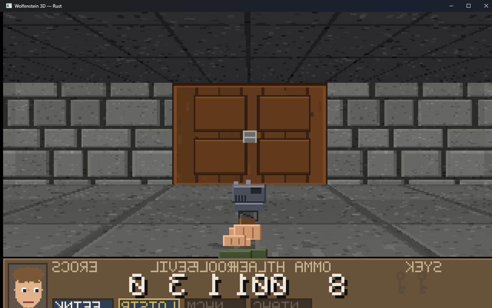

# Raycasted Wolf

A Wolfenstein 3D style shooter in Rust, built on top of
[`markusmoenig/raycaster`](https://github.com/markusmoenig/raycaster), with procedurally generated
art and sound so the whole game is a single self-contained build.



- **Memory safe.** Both crates are `#![forbid(unsafe_code)]`. The only FFI is inside the windowing
  and audio crates, which every desktop app needs.
- **Cross platform.** Windows, macOS and Linux, built and tested on all three in CI. No C toolchain,
  no SDL, no data files to install.
- **No copyrighted assets.** The 1992 art, sounds and maps are id's; everything here is generated
  from code, in the spirit of the original but not a copy of its files.

## Running it

```bash
cargo run --release -p wolf3d
```

Linux needs ALSA headers to build (only for audio):

```bash
sudo apt install libasound2-dev     # Debian/Ubuntu
sudo dnf install alsa-lib-devel     # Fedora
```

If no sound card is available the game says so and runs silently rather than failing.

### Controls

| Key | Action |
| --- | --- |
| `W` `A` `S` `D` / arrows | Move and strafe (`A`/`D` strafe, left/right arrows turn) |
| Mouse | Turn |
| `Shift` | Run |
| `Space` / `E` | Open doors, push secret walls, throw the elevator switch |
| `Ctrl` / left mouse | Fire (hold for the machine gun and chaingun) |
| `1` `2` `3` `4` | Knife, pistol, machine gun, chaingun |
| `Esc` | Pause (and resume) |
| `Q` (paused) | Quit to the difficulty screen |
| `M` | Mute |
| `Enter` / `Space` | Confirm in menus |

## What is in it

Three floors, four difficulty tiers, four weapons and the knife, five enemy types, doors with gold
and silver keys, pushwall secrets, treasure, an animated status-bar face, a kill/secret/treasure
tally between floors, death and lives, game over and a victory screen. The full list is in
[docs/WOLF3D_FEATURES.md](docs/WOLF3D_FEATURES.md).

The floors are original layouts in the style of the original's opening episode, not ports of its
maps: 64x64 tile grids with cells, corridors, kennels, a shrine courtyard, a hidden armoury, a
pushwall stash and an elevator. They are built with a small layout DSL in
[crates/wolf3d/src/levels.rs](crates/wolf3d/src/levels.rs) and validated at load time: every door
has a reachable side, every secret is reachable once its wall has moved, nothing is placed inside a
wall. The validator runs in the test suite, so a broken floor fails `cargo test`.

## How it is put together

```
crates/raycaster/     vendored MIT engine + PATCHES.md (every change we made, and why)
crates/wolf3d/
  src/main.rs         window, input, 70 Hz frame pacing, nearest-neighbour upscale
  src/game.rs         the fixed timestep simulation: doors, pushwalls, AI, shots, pickups
  src/level.rs        level format, layout builder, validation, ASCII map dump
  src/levels.rs       the three floors
  src/player.rs       movement, collision, health, lives, keys, score
  src/weapons.rs      the four weapons and the knife
  src/actors.rs       enemy types, states and damage
  src/objects.rs      pickups and decorations
  src/render.rs       game state -> engine WorldMap, and the 320x200 frame
  src/hud.rs          status bar, face, screens, tally
  src/audio.rs        rodio effects and the music loop, optional device
  src/assets/         procedural textures, sprites, font, sounds
  src/bin/frames.rs   headless harness: renders scenes to PNG, dumps ASCII previews
```

Nothing in `game`, `level`, `render` or `assets` touches a window, a sound card or the clock. That
is what makes the whole game testable and lets `frames` render real frames on a machine with no
display.

Why the engine is vendored rather than used as a git dependency: `Raycaster` keeps its position,
direction and camera plane private and has no door concept, no wall removal and no strafe. The
patches are listed file by file in [crates/raycaster/PATCHES.md](crates/raycaster/PATCHES.md);
upstream is untouched otherwise, so a rebase is a diff against that list.

One design note worth calling out: the engine is tile based, so a pushwall moves one whole tile at a
time. Doors are the exception — the engine slides their texture into the wall frame by frame,
because that is what the original looked like and the renderer already walks the texture columns.

## Assets

Everything is generated at startup from code: 64x64 wall, floor, ceiling and door textures; eight
rotations of five enemy types in standing, walking, firing, pain and dying poses; four weapons with
animation frames; pickups, decorations, the status-bar face and a small bitmap font; 24 sound
effects and a 14 second music loop, all synthesised into memory. Same seed, same art, no downloads,
no licensing to review.

Downloaded art still wins: a 64x64 PNG in `assets/cc0/` named after a texture or sprite replaces
the generated one (see [crates/wolf3d/src/assets/mod.rs](crates/wolf3d/src/assets/mod.rs)).
[tools/fetch_assets.sh](tools/fetch_assets.sh) helps with that:

```bash
tools/fetch_assets.sh            # download the CC0 packs pinned in tools/cc0-manifest.txt
tools/fetch_assets.sh --list     # every name the game will look for
tools/fetch_assets.sh --install assets/cc0/raw/<pack>/<file>.png wall_brick
```

Packs are SHA-256 pinned, verified before unpacking, and a failed download is a warning, never a
broken checkout. Nothing depends on them; delete `assets/cc0/` and the game looks the same as it
did before, just with generated art. The install step is deliberately manual: a downloaded pack has
no idea which of its images is a door and which is a barrel.

## Verification

```bash
cargo test                                  # 92 tests
cargo clippy --all-targets -- -D warnings
cargo run -p wolf3d --bin frames -- --frames --ascii
```

`frames` is how the game is checked without a human at a screen: it renders scripted situations
(spawn, firefight, a guard mid-attack, half-open door, low health, floor tally, title screen) into
PNGs and prints them as ASCII, along with how much of the view is actually lit, which catches a
black frame that a "successful" build hides. It can also dump any PNG as ASCII (`--png FILE`),
which is how the [window screenshots](docs/tools/window-shot.ps1) were inspected: that script
captures the window's client area with `PrintWindow`, because copying the screen also picks up
whatever window is on top of the game.

The PNGs in [docs/gallery](docs/gallery) are produced by that harness, and the two `window_*.png`
files are real screenshots of the running binary. There is a page to look at them all:
[`docs/gallery/index.html`](docs/gallery/index.html).

## Limitations

- Local verification was done on Windows. macOS and Linux are covered by the CI matrix, not by a
  human playing them here.
- The renderer is the original's 320x200 software raycaster: no looking up and down, no
  translucent surfaces, no floor/ceiling casting beyond flat textures.
- Mouse look reads relative motion and does not hide or lock the cursor.
- The sound is synthesised: it is meant to sit in the same register as the original, not to
  reproduce it.

## License

MIT. See [LICENSE](LICENSE). The vendored engine in `crates/raycaster` is MIT as well.
